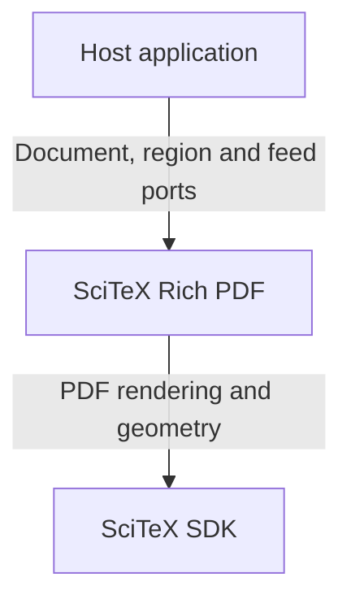

# SciTeX Rich PDF

<p align="center">
  <a href="https://scitex.ai"></a>
</p>
<p align="center"><b>Embeddable PDF regions, comments, and a synchronized feed.</b></p>
<p align="center">
  <a href="docs/sphinx/index.md">Full Documentation</a> · <code>pip install scitex-rich-pdf</code>
</p>

<!-- scitex-badges:start -->
<p align="center">
  <a href="https://pypi.org/project/scitex-rich-pdf/"></a>
  <a href="https://pypi.org/project/scitex-rich-pdf/"></a>
  <a href="https://github.com/scitex-ai/scitex-rich-pdf/actions/workflows/docs.yml"></a>
</p>
<p align="center">
  <a href="https://github.com/scitex-ai/scitex-rich-pdf/actions/workflows/ci.yml"></a>
  <a href="https://codecov.io/gh/scitex-ai/scitex-rich-pdf"></a>
</p>
<!-- scitex-badges:end -->

Rich PDF is an embeddable PDF viewer with region overlays, comments, and a
synchronized feed for SciTeX applications. The host supplies document access, feed content, and action
handlers. The SciTeX SDK supplies PDF rendering and coordinate transforms.

## Quick Start

Mount a viewer with the [embedding example](examples/embed.js). It uses an
unanchored reading note so you can start with any PDF.

## Installation

Install the Python distribution and locate its browser assets.

```sh
pip install scitex-rich-pdf
python -c 'import scitex_rich_pdf; print(scitex_rich_pdf.get_frontend_package_dir())'
```

Use the printed directory as an npm file dependency alongside a provider-capable
`@scitex/sdk` installation (0.3.25 or later). Both frontend packages can be
resolved from their Python distributions in the host's build. No npm registry
publication is required.

```js
import { createPdfViewer } from "@scitex/sdk/ui/pdf-viewer";
import { createRichPdfViewer } from "@scitex/rich-pdf";
import "@scitex/rich-pdf/pdf-provider.css";

const viewer = createRichPdfViewer({
  container: pdfElement,
  feedContainer: feedElement,
  createPdfViewer,
  ports: {
    documents: { resolve: resolveDocument },
    overlays: { list: listRegions },
    feed: { list: listEntries, renderEntry: renderEntryDetails },
    events: { emit: handleEvent },
  },
});
await viewer.load(documentKey);
```

The host places the PDF and feed containers in its layout. The feed is optional.
Use a document key that describes the current revision, and call `load` again
when the revision changes. Return a document with `id`, `src`, and optional
`revision` and `readonly` fields.

Regions have an `id`, a one-based `page`, and a bounding box
`[x0, y0, x1, y1]` in bottom-left PDF coordinates. Feed entries have an `id`,
`label`, and optional `overlayId` and `data`. An unanchored entry remains
selectable. Clicking a PDF rectangle selects the matching feed entry. Clicking
a feed entry selects and scrolls to its rendered rectangle when available.
The optional `renderEntry` callback returns DOM content for details and host
actions. The host can handle `overlay-preview` events from hover or keyboard
focus, as well as `overlay-select` and `feed-select` events.

Choose `appearance: "highlight"` for a translucent text or value mark and
`appearance: "region"` for an edge affordance on a figure. The optional
`ports.preview.render(container, overlay, signal)` callback supplies content
for the overlay's dialog. The component opens it on hover or keyboard focus.
Activation pins it and moves focus into the dialog. Escape dismisses it and
returns focus to the mark. Use the abort signal to cancel pending work when the
dialog closes. Hosts still supply and authorize any evidence content.

The component also accepts comment, pen-input, and mutation-policy ports.
See the bundled TypeScript declarations for the complete interface. Perform
authorization and persistence in the host. Call `destroy` to remove component
UI and dispose of the renderer.

## Architecture



Live Paper uses the component for scientific claim details and actions. The
[scientific paper architecture](https://scitex-live-paper.readthedocs.io/en/latest/architecture.html)
describes the complete workflow.

## Three Interfaces

| Interface | Entry point |
| --- | --- |
| Browser module | `@scitex/rich-pdf` exports `createRichPdfViewer` |
| Python API | `scitex_rich_pdf.get_frontend_package_dir()` |
| Skills | `scitex-dev dev skills list --package scitex-rich-pdf --json` |

### Build the documentation

The package provides the `scitex-rich-pdf` skill through SciTeX Dev. With
both packages installed, find it with
`scitex-dev dev skills list --package scitex-rich-pdf --json`.

Build the Sphinx documentation with `pip install -e '.[docs]'` and
`sphinx-build -W --keep-going docs/sphinx docs/sphinx/_build/html`.

## Part of SciTeX

`scitex-rich-pdf` is part of [SciTeX](https://scitex.ai). The provider
originated in [SciTeX Live Paper](https://github.com/scitex-ai/scitex-live-paper/tree/4790067f113df49618031c5bab1e679cadcd36bf).

>Four Freedoms for Research
>
>0. The freedom to **run** your research anywhere — your machine, your terms.
>1. The freedom to **study** how every step works — from raw data to final manuscript.
>2. The freedom to **redistribute** your workflows, not just your papers.
>3. The freedom to **modify** any module and share improvements with the community.
>
>License: AGPL-3.0-only.

<p align="center">
  <a href="https://scitex.ai"></a>
</p>
